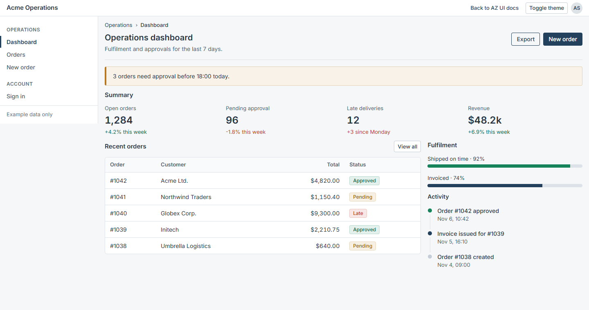
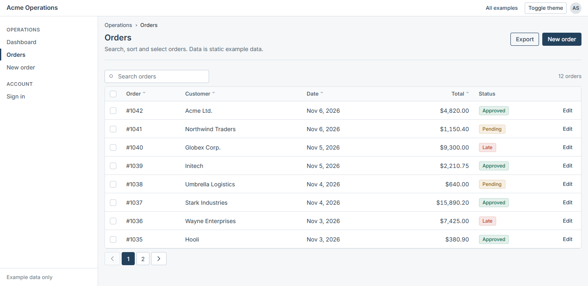
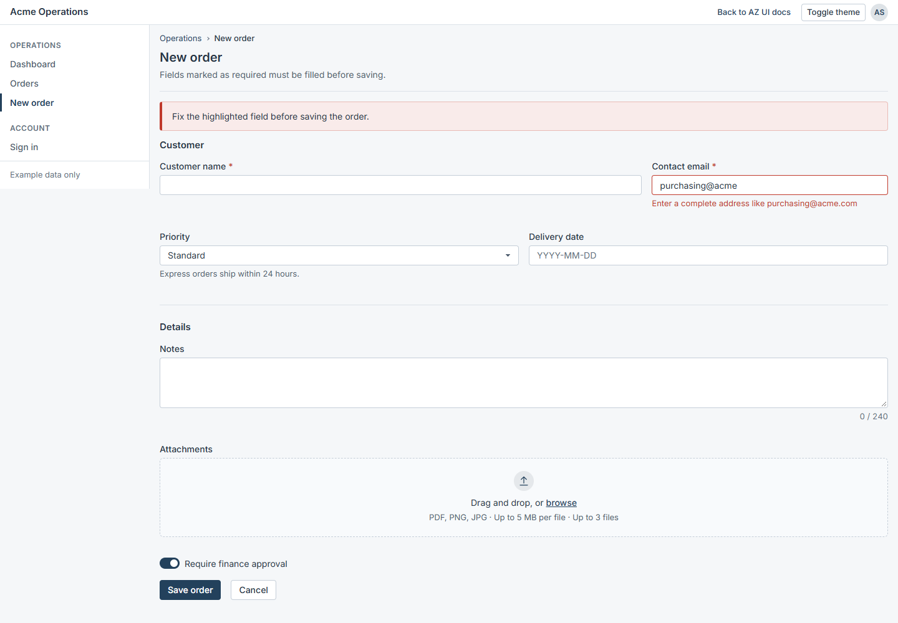

<div align="center">

# AZ UI

**Component library and Design System for enterprise web applications.**
Plain CSS and TypeScript. No framework required.

<picture>
  <source media="(prefers-color-scheme: dark)" srcset="docs/images/dashboard-dark.png" />
  
</picture>

<sub>A complete screen built only with AZ UI components, in the light and dark themes.</sub>

</div>

---

AZ UI gives corporate, administrative and management systems one consistent interface layer: dense tables, long forms, dashboards, accessible overlays and full page layouts. Components are classes on native HTML elements, with TypeScript behavior where interaction is needed, so it fits server-rendered templates, single-page apps and every major framework.

- npm package: `az-ui` (not published yet) · CSS prefix `az-` · JavaScript namespace `AZUI`
- MIT licensed · pre-release `0.x` · TypeScript types included · zero runtime dependencies

## Why AZ UI

| Need                        | What AZ UI does                                                                                         |
| --------------------------- | ------------------------------------------------------------------------------------------------------- |
| Screens full of data        | Dense defaults (32px controls, 15px type) and a `DataTable` with sorting, search, pagination, selection |
| Forms with dozens of fields | Validation states, select and multi-select, datepicker, file upload, character counter, declarative API |
| One look across products    | Every color, size and radius is a CSS token. Rebrand globally or per section by overriding tokens       |
| Accessibility obligations   | WCAG 2.2 AA target: semantic HTML, visible focus, keyboard operation, focus management, reduced motion  |
| Mixed technology stacks     | No framework dependency: PHP and Twig templates, React, Vue, Angular, Svelte, plain HTML                |
| Predictable upgrades        | Semantic Versioning and a documented public API                                                         |

## Screens

<table>
  <tr>
    <td width="50%">
      <picture>
        <source media="(prefers-color-scheme: dark)" srcset="docs/images/orders-dark.png" />
        
      </picture>
      <br /><sub><b>Data table</b>: search, sorting, selection and pagination.</sub>
    </td>
    <td width="50%">
      <picture>
        <source media="(prefers-color-scheme: dark)" srcset="docs/images/order-form-dark.png" />
        
      </picture>
      <br /><sub><b>Forms</b>: validation, datepicker, file upload and counters.</sub>
    </td>
  </tr>
</table>

## What is included

| Area                    | Components                                                                                                                            |
| ----------------------- | ------------------------------------------------------------------------------------------------------------------------------------- |
| Foundations             | Color scales, typography (Inter, IBM Plex Sans, Source Sans 3), spacing, borders, shadows, motion, layers, breakpoints, utilities     |
| Themes                  | Light and dark, selected with `data-az-theme` and scoped to any element                                                               |
| Basic                   | Button, Badge, Alert, Avatar, Card, Divider, Skeleton, Spinner and 253 icons                                                          |
| Forms                   | Input, textarea, select, multi-select, checkbox, radio, switch, range, file upload, datepicker, input group, counter, `AZUI.Form`     |
| Overlays and navigation | Modal, Offcanvas, Dropdown, Tooltip, Popover, Tabs, Accordion, Toast, Notification, Command menu, Context menu                        |
| Data                    | Table, DataTable, Pagination, Filter, Search, Toolbar, Timeline, Progress, Stat, Status indicator, Key value, List group, Empty state |
| Layouts                 | Container, Grid, Row and Column, Stack, Split layout, Page header, Content section, Breadcrumb, Navigation menu, Navbar, Sidebar      |
| Interaction             | Collapse, Sortable (drag and drop), Kanban, Tree, Stepper, Splitter                                                                   |
| Data entry              | Mask, Tag input, Combobox, Dual listbox, Date range, Barcode input                                                                    |

## Quick start

```bash
npm install az-ui
```

```ts
import "az-ui/styles.css";
import "az-ui/auto"; // optional: initializes components from data-az-* attributes
```

Components are classes on native elements:

```html
<html lang="en" data-az-theme="light">
  <body class="az-body">
    <section class="az-card">
      <div class="az-card-header">Approve order #1042</div>
      <div class="az-card-body">Acme Ltd. · 14 items · $4,820.00</div>
      <div class="az-card-footer az-stack az-stack-horizontal az-stack-sm">
        <button class="az-btn az-btn-primary" type="button">Approve</button>
        <button class="az-btn" type="button">Reject</button>
      </div>
    </section>
  </body>
</html>
```

Interactive components share one lifecycle (`show`, `hide`, `destroy`) and emit cancelable events:

```ts
import { Modal } from "az-ui";

const modal = new Modal("#confirm");
document.addEventListener("az:modal:hide", (event) => {
  if (hasUnsavedChanges()) event.preventDefault();
});
modal.show();
```

Forms can be described instead of written:

```ts
import { AZUI } from "az-ui";

form.append(
  AZUI.Form.email({ name: "email", label: "Work email", required: true }),
  AZUI.Form.select({
    name: "priority",
    label: "Priority",
    options: [{ value: "high", label: "High" }],
  }),
);
```

## Theming

Override tokens, not component selectors:

```css
:root {
  --az-color-primary: #0b5c3a;
  --az-radius-md: 2px;
  --az-control-height-md: 36px;
}
```

## Documentation

Reference for every public API lives in [`docs/`](docs):

- Components: [`docs/components/`](docs/components) (classes, options, events, states and accessibility for each one)
- [Declarative form API](docs/forms/declarative-api.md) and [JavaScript API](docs/javascript/overview.md)
- Foundations: [colors](docs/foundations/colors.md), [typography](docs/foundations/typography.md), [spacing and tokens](docs/foundations/spacing-and-tokens.md), [themes](docs/foundations/themes.md), [utilities](docs/foundations/utilities.md)
- Guides: [installation](docs/getting-started/installation.md), [quick start](docs/getting-started/quick-start.md), [customization](docs/guides/customization.md), [accessibility](docs/guides/accessibility.md), [PHP and server-side](docs/guides/php.md), [frameworks](docs/guides/frameworks.md), [versioning and roadmap](docs/guides/versioning.md)

## Browser support

The last two versions of Chrome, Edge, Firefox, Safari and iOS Safari.

## Status

Foundations, components, data components and layouts are implemented and covered by automated tests. The first npm release is planned after the documentation and distribution phases. See [Versioning and roadmap](docs/guides/versioning.md).

## Development

```bash
npm install
npm run build         # dist/: ESM, types, CSS and fonts
npm test              # unit tests (includes dist/ when it exists)
npm run typecheck
npm run lint
```

Project context for contributors lives in [`.ai/`](.ai/README.md). See [CONTRIBUTING.md](CONTRIBUTING.md) for the workflow and [SECURITY.md](SECURITY.md) to report vulnerabilities.

## License

[MIT](LICENSE). Bundled fonts keep their SIL Open Font License in `fonts/<family>/`.
